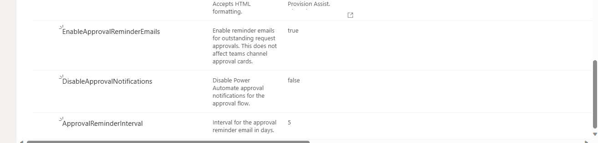

# Godkjenningsflyt

Bestillingsportalen godkjenner bestillinger med Azure Logic Appen **`ProcessApprovalRequest`**. Den deployes av `deploy.ps1` sammen med de øvrige Logic Appene. Fra versjon 1.2.0 erstatter den Power Automate-flyten `Provisioning Request Approval`, som ble brukt i tidligere versjoner. Se [Upgrade.md](/Upgrade.md#oppgradere-til-120-godkjenningsflyten-erstattes) for migrering.

> [!IMPORTANT]
> Logic Appen er bygd på nytt fra standardflyten. Har dere tilpasset Power Automate-flyten selv, er ingen av tilpasningene med i Logic Appen. Se [Upgrade.md](/Upgrade.md#oppgradere-til-120-godkjenningsflyten-erstattes) før dere oppgraderer.

Godkjenningen kan konfigureres på tre måter:

- **Godkjennings-e-post**: En e-post med Approve/Reject-knapper sendes til godkjenner(ne) via Office 365 Outlook-connectoren.
- **Teams adaptivt kort**: Et adaptivt kort postes i en Teams-kanal.
- **Av**: Med `EnableAutoApproval` godkjennes alle bestillinger automatisk og går rett til provisjonering. Se [Slå av godkjenningen](#slå-av-godkjenningen).

Logic Appen kjører når statusen på en bestilling i **`Provisioning Requests`**-listen endres til **`Submitted`**, det vil si når brukeren sender inn bestillingen i webdelen eller Teams-appen.

Når du installerer løsningen, sørg for å følge «Steg 1: Konfigurere godkjenningsprosess» i [Konfigurasjonsveiledningen](/Configuration-guide.md) for å sette opp godkjenning. Hvis du vil endre godkjenningsmetoden, for eksempel bytte fra godkjennings-e-post til Teams adaptive cards, følger du samme steg i veiledningen.

## Påminnelser om godkjenning

Hvis godkjenningsprosessen er konfigurert til å bruke godkjennings-e-post, kan påminnelses-e-poster sendes til godkjenner(ne). Disse konfigureres i `Provisioning Request Settings`-listen.

Rediger listeelementene og endre verdien etter behov:

- **`EnableApprovalReminderEmails`** – Aktiver eller deaktiver påminnelses-e-poster til godkjennerne (`true`/`false`).
- **`ApprovalReminderInterval`** – Intervall (i dager) mellom hver påminnelses-e-post til godkjennerne. Påminnelsene sendes til noen svarer.
- **`DisableApprovalNotifications`** – *Utgått.* Innstillingen styrte de innebygde varslene fra Power Automate Approvals og har ingen effekt i Logic Appen. Den beholdes i listen for bakoverkompatibilitet.

## Varsel når området er opprettet

Når `ProcessProvisionRequest` har opprettet og konfigurert området, sender den et «Område opprettet»-varsel som Teams-kort (`Post_space_created_adaptive_card`) og e-post (`Send_space_created_email`). Mottakeren er den bestillingen ble registrert på vegne av (`RequestedBy`), ellers bestilleren (`Author`).

- **`NotifyApproverOnSpaceCreated`** – Når `true`, sendes samme kort og e-post også til godkjenneren av bestillingen (`Approver`). Nyttig når godkjenneren skal sette opp området etterpå, for eksempel med Prosjektportalens oppsettveiviser. Varselet hoppes over når godkjenneren er den samme som bestilleren, og når bestillingen ble automatisk godkjent og derfor ikke har noen godkjenner. Standardverdien er `false`.

## Prosess

På et overordnet nivå fungerer `ProcessApprovalRequest` slik:

1. Henter innstillinger fra `Provisioning Request Settings`-listen, og godkjennere fra `Business Units`-listen hvis forretningsenheter er aktivert.
2. Godkjenner bestillingen automatisk og stopper hvis `EnableAutoApproval` er på.
3. Sender en bekreftelses-e-post til bestilleren og oppdaterer statusen på bestillingen til `Pending Approval`, eller godkjenner automatisk når `EnablePublicSpaceApprovalOnly` gjelder.
4. Sender enten en godkjennings-e-post med Approve/Reject-knapper til godkjenner(ne) ELLER poster et Teams adaptive card i den konfigurerte kanalen.
5. Venter på svar i inntil 60 dager og sender påminnelses-e-poster til godkjenner(ne) etter påminnelsesinnstillingene. Kommer det ikke svar innen fristen, settes statusen tilbake til `Submitted`, og en ny godkjenningsrunde starter.
6. Skriver den som svarte i `Approver`-kolonnen, og oppdaterer deretter statusen til `Approved` eller `Rejected`, med godkjenner og svardato i `Comments`.
7. Sender e-post og adaptive card i Teams til bestilleren for å varsle om utfallet.

Bestillinger som blir `Approved` trigger provisjonering.

Avviste bestillinger kan redigeres av brukere i webdel eller Teams app og sendes inn på nytt.

Du kan redigere Logic Appen i Azure-portalen, men endringene overskrives neste gang `deploy.ps1` kjøres, både full installasjon og `-Upgrade`. Varige tilpasninger gjøres i `Source/ARMTemplates/LogicApps/processapprovalrequest.json`.

### Forskjeller mellom de to metodene

- **Godkjennings-e-post**: Godkjenneren svarer med Approve/Reject-knappene direkte i e-posten (actionable message i Outlook). Når flere godkjennere er konfigurert, avgjør første svar utfallet. E-posten har ikke kommentarfelt. Trenger dere begrunnelse fra godkjenneren, bruk Teams-metoden. Hvem som svarte registreres i `Approver`-kolonnen når svaret kommer via knappene i e-posten. Svar via reservelenken, som blant annet mottakere utenfor tenanten får, registreres uten identitet.
- **Teams adaptivt kort**: Kortet postes i den konfigurerte kanalen, og alle med tilgang til kanalen kan svare. Godkjenneren kan legge inn en kommentar, og navnet på den som svarte registreres i `Comments` og `Approver`-kolonnen. Private kanaler støttes ikke av Teams-connectoren.

## Slå av godkjenningen

Sett **`EnableAutoApproval`** til `true` i `Provisioning Request Settings` for å slå av godkjenningen. Da godkjennes alle bestillinger automatisk:

- Webdelen og Teams-appen oppretter bestillingen med status `Approved`, så den går rett til provisjonering.
- Kommer en bestilling inn som `Submitted` på en annen måte, for eksempel lagt rett i listen, godkjenner `ProcessApprovalRequest` den automatisk. Bestilleren får ikke e-posten om at bestillingen er sendt til godkjenning, og `Comments` får teksten «Auto approved - approval is turned off (EnableAutoApproval).».

Alt annet enn tom verdi og `false` slår innstillingen på, både i webdelen og i Logic Appen. Automatisk godkjente bestillinger har ingen godkjenner, så `NotifyApproverOnSpaceCreated` har ingen effekt for dem.

## Godkjenning kun av `Public`-områder

Bestillingsportalen kan konfigureres til kun å kreve godkjenning for `Public`-områder. Hvis konfigurert, vil bestillinger satt til `Private` automatisk godkjennes av godkjenningsprosessen.

En innstilling i `Provisioning Request Settings` aktiverer/deaktiverer funksjonaliteten.

Oppdater verdien på innstillingen **`EnablePublicSpaceApprovalOnly`** til `true` eller `false`.

Dette er designet for organisasjoner der `Private`-områder anses å ha lavere risiko enn `Public`-områder.

**Merk: Dette alternativet er kanskje ikke tilgjengelig i den installerte versjonen av Bestillingsportalen.** Kjør en [oppgradering](Upgrade.md) (eller re-appliser PnP-malen) — manglende standardinnstillinger, inkludert **`EnablePublicSpaceApprovalOnly`**, opprettes da automatisk med standardverdi uten at eksisterende innstillinger endres. Aktiver eller deaktiver deretter funksjonaliteten ved å sette `Value` på elementet til `true` eller `false` i `Provisioning Request Settings`-listen.
